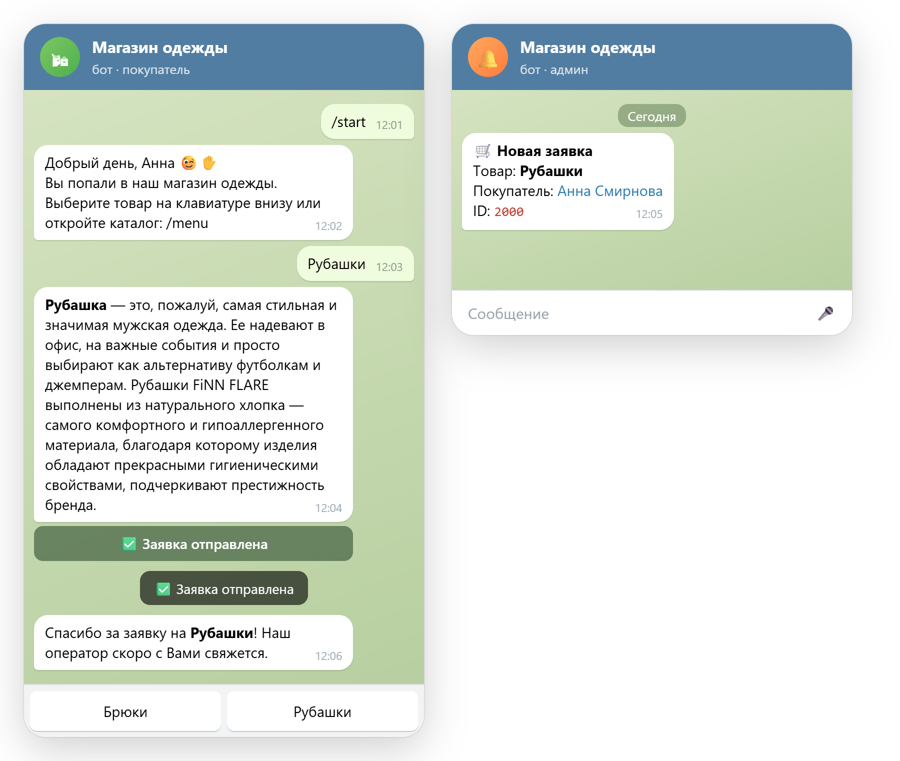
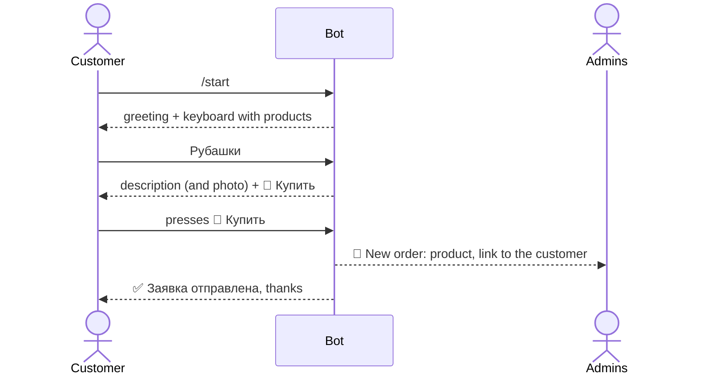

<div align="center">

# 🛍 shop-telebot

**A small Telegram shop. Products are HTML files in a folder, customers press
"Buy", and the order goes to the admins.**

No database and no admin panel: add a file to the folder and the product
appears in the bot, while it is running.

[](https://github.com/mredwardlik/shop-telebot/actions/workflows/tests.yml)




<sub>The chat is drawn from the bot's real replies in the tests.</sub>

</div>

---

## ✨ Features

- 🗂 **Catalog from files**: `views/products/Брюки.html` is the product
  "Брюки". A number in front of the name sets the order (`1 Рубашки.html`),
  a picture with the same name (`.jpg`, `.png`, `.webp`) is sent as a photo
- ⌨️ **Two ways to choose**: a keyboard with the products under the input
  field, and an inline catalog in `/menu`. Typed names work too, in any case
- 🛒 **Orders**: the "Buy" button sends the order with a link to the customer
  to every admin, and turns into "✅ Заявка отправлена"
- 🔁 **Live editing**: products and texts are read again when they change,
  no restart needed
- ✍️ **All texts are templates** in `views/`, with Telegram HTML and
  placeholders like `{user.first_name}` or `{product.name}`. Names of users
  are escaped, so nobody can break the markup
- 🛡 **Doesn't fall**: broken HTML is sent as plain text, an admin who hasn't
  started the bot doesn't stop the others from getting the order, errors are
  logged

## 🔄 How an order goes



## 🚀 Quick start

1. Create a bot with [@BotFather](https://t.me/BotFather) and copy its token.
2. Find your Telegram id with [@userinfobot](https://t.me/userinfobot).
3. Install and configure:

   ```bash
   git clone https://github.com/mredwardlik/shop-telebot.git
   cd shop-telebot
   pip install -e .
   cp config.example.env config.env     # then put TOKEN and ADMINS into it
   ```

4. Check the settings and start:

   ```bash
   python -m shop_telebot --check       # products, views and admins, without Telegram
   python -m shop_telebot
   ```

On Windows `start.bat` does steps 3 and 4: it makes a virtual environment in
`.env` on the first run and starts the bot.

Every admin must press **Start** in the bot once, otherwise Telegram doesn't
let the bot write to them.

## ⚙️ Settings

`config.env` (not committed, see [`config.example.env`](config.example.env)).
Every key can also be an environment variable, for example on a server:
`TOKEN=... ADMINS=... python -m shop_telebot`.

| Key              | Default               | Description                                    |
| ---------------- | --------------------- | ---------------------------------------------- |
| `TOKEN`          |                       | token from @BotFather                          |
| `ADMINS`         |                       | ids of admins who get orders, comma-separated  |
| `VIEWS_DIR`      | `views`               | folder with texts, relative to config.env      |
| `PRODUCTS_DIR`   | `views/products`      | folder with products                           |
| `BUY_BUTTON`     | `🛒 Купить`           | text of the buy button                         |
| `ORDERED_BUTTON` | `✅ Заявка отправлена` | the button after the order                     |
| `ROW_WIDTH`      | `2`                   | product buttons in a row of the keyboard       |

## ✍️ Views

| File               | When it is sent                                | Placeholders                    |
| ------------------ | ---------------------------------------------- | ------------------------------- |
| `start.html`       | `/start`                                       | `user`, `message`, `product`    |
| `start_admin.html` | `/start` from an admin                         | same                            |
| `menu.html`        | `/menu`, above the inline catalog              | same                            |
| `sent.html`        | to the customer after an order                 | `user`, `product`, `call`       |
| `sent_admin.html`  | to the admins after an order                   | same                            |
| `no_product.html`  | a text that isn't a product                    | `user`, `message`               |
| `no_command.html`  | an unknown `/command`                          | same                            |

`user` is the Telegram user (`{user.id}`, `{user.first_name}`,
`{user.full_name}`, `{user.username}`), `product` is the chosen product
(`{product.name}`, `{product.description}`, `{product.count}`). Formatting is
[Telegram HTML](https://core.telegram.org/bots/api#html-style): `<b>`, `<i>`,
`<u>`, `<s>`, `<a href>`, `<code>`, `<blockquote>`. A missing view is
replaced with a default text and a warning in the log.

## 🛠 Development

```bash
pip install -e ".[dev]"
pytest
```

The tests run the bot against a fake Telegram API: every handler, orders,
admins who blocked the bot, photos, live reload, broken HTML and settings.

## 🗂 Project structure

```text
shop-telebot/
├── shop_telebot/
│   ├── bot.py          # handlers: catalog, product cards, orders
│   ├── catalog.py      # products from files
│   ├── views.py        # templates with escaping
│   ├── settings.py     # config.env and environment variables
│   └── __main__.py     # python -m shop_telebot [--check]
├── views/              # texts of the bot
│   └── products/       # one file per product
├── config.example.env
├── start.bat
└── tests/
```

## 📄 License

[MIT](LICENSE)
